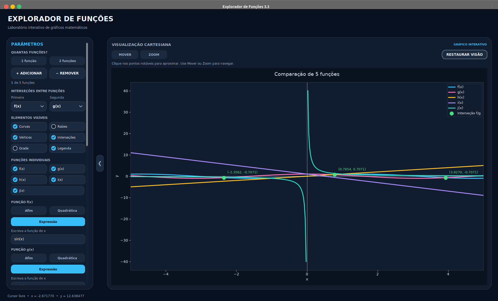

# 📈 Explorador de Funções

Aplicação desktop desenvolvida em **Python** para visualizar, analisar e comparar funções matemáticas por meio de gráficos interativos.

## Sobre o projeto

O **Explorador de Funções** é uma ferramenta educacional que integra programação e matemática, permitindo representar até cinco funções simultaneamente e explorar suas propriedades por meio de uma interface gráfica intuitiva.

## Demonstração



## Funcionalidades

- Visualização de até **cinco funções** simultaneamente.
- Suporte a funções **afins, quadráticas e expressões matemáticas**.
- Adição e remoção dinâmica de funções.
- Cálculo de raízes, vértices, discriminante e interseções.
- **Raízes numéricas de expressões não polinomiais**, destacadas no gráfico.
- Interseções numéricas entre diferentes tipos de funções.
- Cursor de precisão com **seis casas decimais**.
- Zoom inteligente em pontos notáveis, incluindo raízes numéricas.
- Navegação interativa com zoom e movimentação.
- Painel recolhível e **controle de visibilidade** de curvas individuais, raízes, vértices, interseções, grade e legenda.
- Interface escura com controles personalizados.
- Exportação de gráficos em **PNG**.

## Expressões matemáticas

O programa permite inserir expressões como:

```text
x^2 - 4*x + 3
sin(x)
cos(x) + 2
sqrt(x)
log(x)
1/x
```

São suportadas operações aritméticas, funções trigonométricas, logaritmos, exponenciais e constantes matemáticas como `pi` e `e`.

Use `*` para multiplicações, como em `2*x`. As funções trigonométricas utilizam radianos.

## Tecnologias utilizadas

- **Python** — linguagem principal.
- **Tkinter** — interface gráfica.
- **Matplotlib** — visualização e interação com gráficos.
- **Git e GitHub** — controle de versões.

## Estrutura do projeto

```text
Explorador-funcoes/
├── README.md
├── .gitignore
├── images/
│   └── interface.png
└── explorador-funcoes/
    ├── explorador.py
    ├── interface.py
    ├── matematica.py
    ├── visualizacao.py
    ├── expressoes.py
    ├── intersecoes.py
    └── cursor_precisao.py
```

## Instalação e execução

**1. Clone o repositório:**

```bash
git clone https://github.com/MuriStack/Explorador-funcoes.git
cd Explorador-funcoes
```

**2. Prepare o ambiente:**

```bash
python3 -m venv .venv
source .venv/bin/activate
pip install matplotlib
```

No Ubuntu e derivados, instale o Tkinter caso necessário:

```bash
sudo apt install python3-tk
```

**3. Execute a aplicação:**

```bash
cd explorador-funcoes
python interface.py
```

A versão original de terminal também está disponível:

```bash
python explorador.py
```

## Limitações

- A análise **algébrica** de raízes e vértices é limitada a polinômios de grau até dois.
- Raízes e interseções numéricas são aproximações e podem não identificar todos os pontos.
- As buscas numéricas consideram o intervalo configurado.

## Autor

Desenvolvido por [MuriStack](https://github.com/MuriStack).

---

Projeto educacional que integra programação, matemática e visualização gráfica.